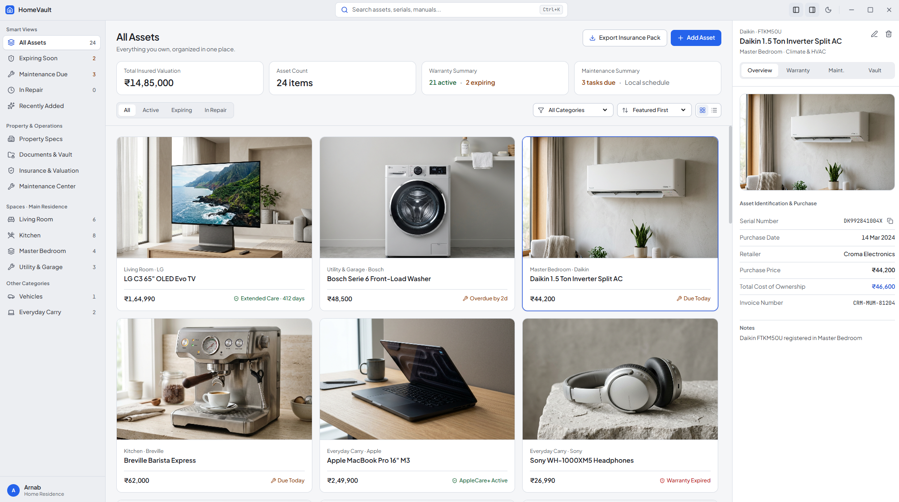
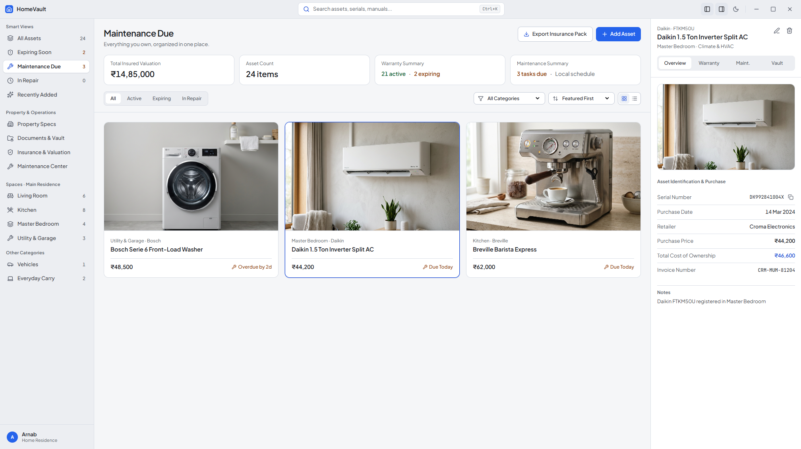
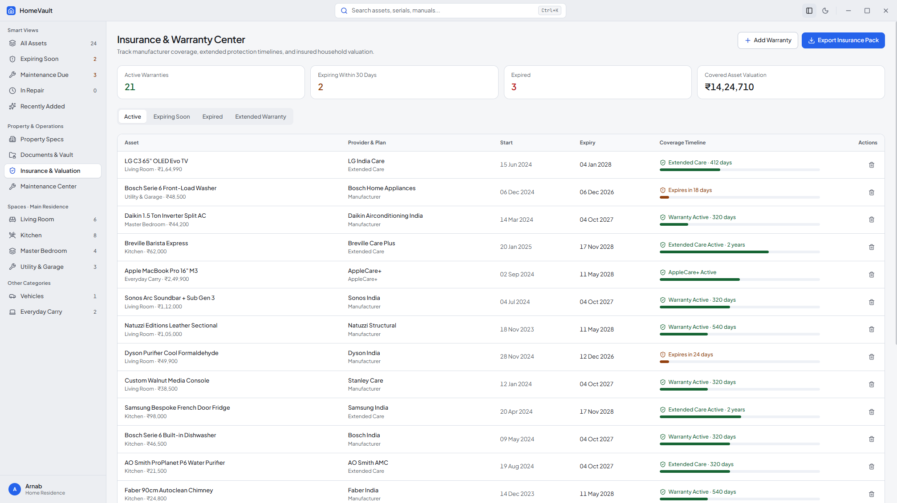
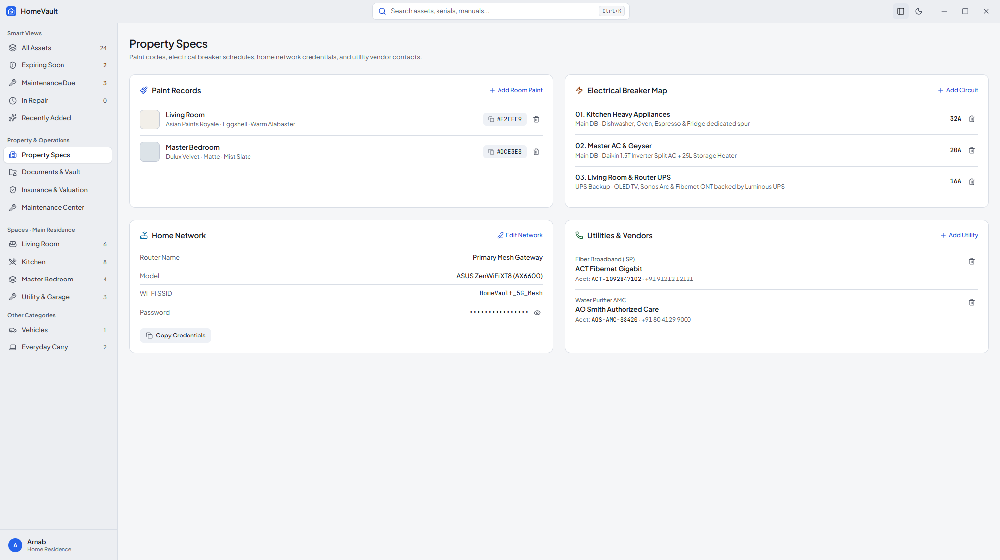
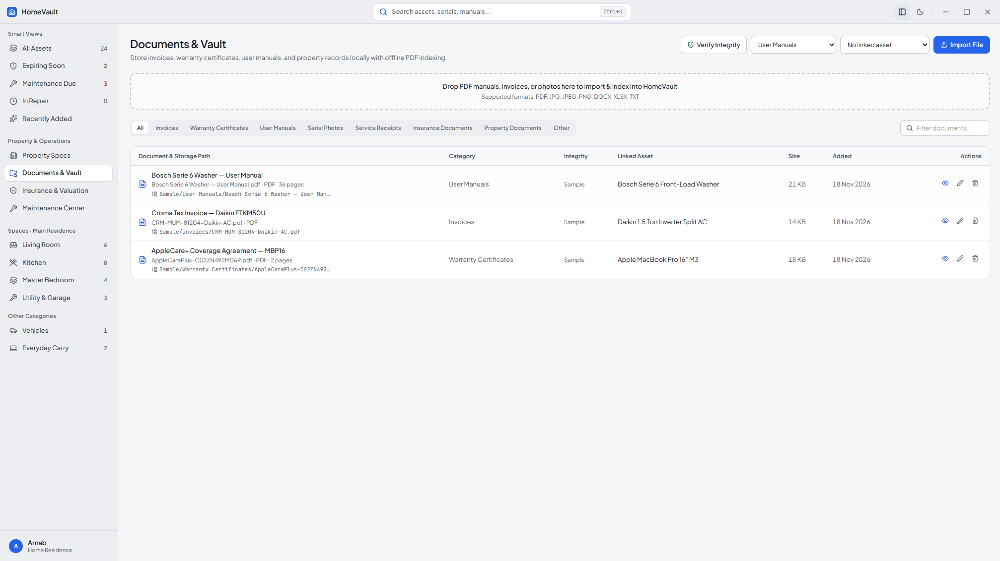
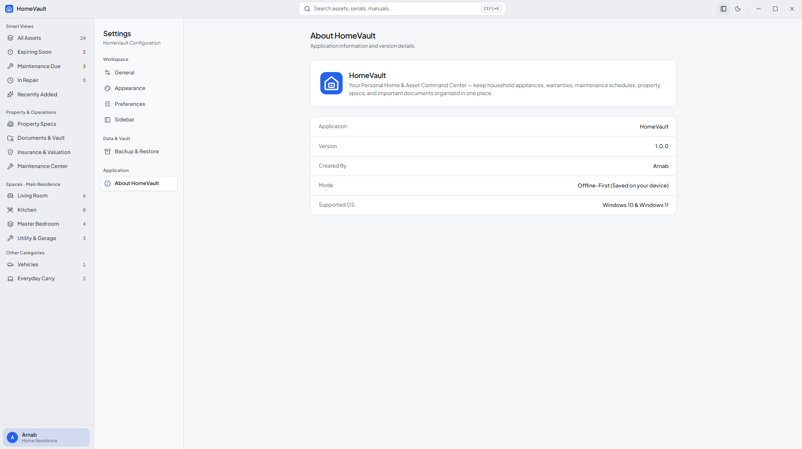
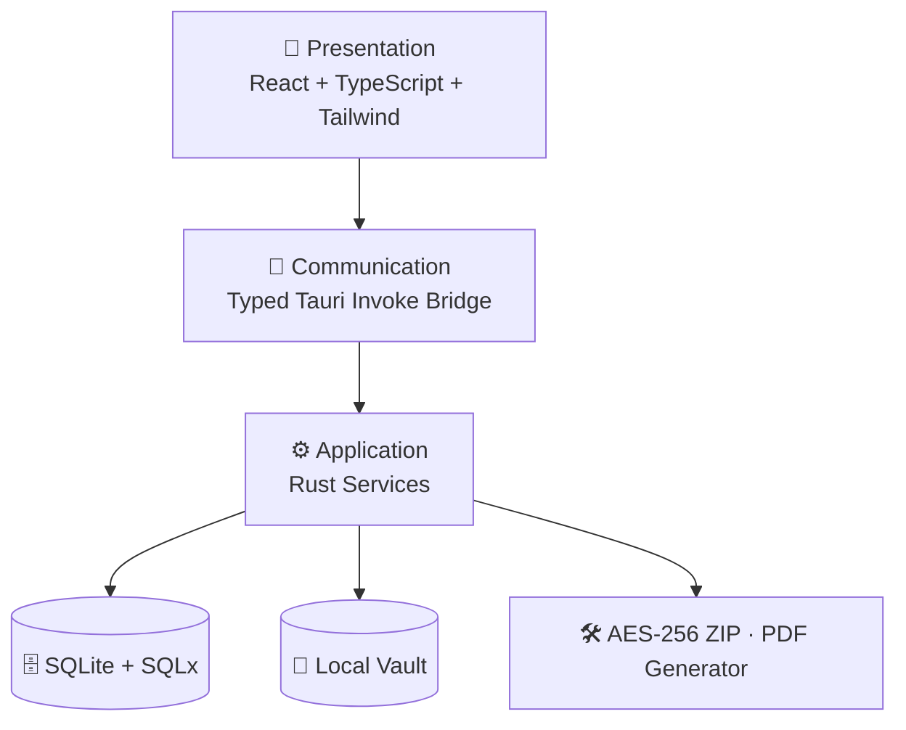

<a id="readme-top"></a>

<div align="center">


### 🏡 A local-first home & asset command center for Windows

**Manage your home, belongings, documents, and household records in one place, with every byte stored on your own device.**

<br />

<a href="https://github.com/arnabsaha7/ItemCare/releases/latest"></a>


<br /><br />

[**Download**](#-download) ·
[**Features**](#-features) ·
[**Screenshots**](#-screenshots) ·
[**Quick Start**](#-quick-start) ·
[**Architecture**](#-architecture) ·
[**Roadmap**](#-roadmap) ·
[**Contributing**](#-contributing)

</div>

<br />

---

## 📸 Screenshots

<table align="center">
  <tr>
    <td align="center" width="50%">
      
      <br /><sub><b>📊 Dashboard & Assets</b> · your home at a glance</sub>
    </td>
    <td align="center" width="50%">
      
      <br /><sub><b>🛠️ Maintenance</b> · keep your belongings in shape</sub>
    </td>
  </tr>
  <tr>
    <td align="center" width="50%">
      
      <br /><sub><b>🛡️ Insurance</b> · organize policies and important files</sub>
    </td>
    <td align="center" width="50%">
      
      <br /><sub><b>🏠 Property Specs</b> · centralized home information</sub>
    </td>
  </tr>
  <tr>
    <td align="center" width="50%">
      
      <br /><sub><b>🔐 Vault</b> · local attachment storage</sub>
    </td>
    <td align="center" width="50%">
      
      <br /><sub><b>⚙️ Settings</b> · application preferences</sub>
    </td>
  </tr>
</table>

---

## 📥 Download

Grab the latest Windows installer from the [**Releases page**](https://github.com/arnabsaha7/ItemCare/releases/latest).

| File | Description |
|---|---|
| `.msi` | Standard Windows Installer |
| `.exe` | Setup executable |

> [!NOTE]
> Builds are not code-signed yet, so Windows SmartScreen may show a warning on first launch. Click **More info → Run anyway** to continue.

---

## 💡 Why ItemCare?

Receipts, warranties, manuals, and household records usually end up scattered across folders, spreadsheets, and a dozen apps. **ItemCare brings it all into one organized workspace, and keeps it private.**

<table>
  <tr>
    <td width="50%" valign="top">

**🗂️ Everything in one place**<br />
One command center for your home and personal assets.

</td>
    <td width="50%" valign="top">

**🔒 Your data stays yours**<br />
Local-first by design: SQLite plus local attachment storage. No cloud backend required.

</td>
  </tr>
  <tr>
    <td width="50%" valign="top">

**⚡ Native and fast**<br />
Built on Tauri 2 and Rust for a lightweight native Windows app.

</td>
    <td width="50%" valign="top">

**🧩 Modern and maintainable**<br />
A typed React frontend talking to native Rust services over a typed bridge.

</td>
  </tr>
</table>

---

## ✨ Features

| | Feature | What you get |
|:-:|---|---|
| 🏠 | **Home Management** | A centralized workspace for household information |
| 📦 | **Asset Management** | Organize and manage your personal assets |
| 🛠️ | **Maintenance** | Keep track of upkeep for your belongings |
| 🛡️ | **Insurance** | Keep insurance records and important files organized |
| 📄 | **Document Management** | Keep important household documents and files together |
| 🔐 | **Local Vault** | Dedicated local storage for attachments |
| 🗄️ | **Local Database** | Structured persistence powered by SQLite |
| 🔏 | **Encrypted Archives** | AES-256 ZIP support for archive handling |
| 🧾 | **PDF Generation** | Generate PDF documents |
| 🖥️ | **Native Runtime** | Windows desktop app powered by Tauri 2 |
| 🌐 | **Browser Preview** | Browser-compatible persistence for fast frontend development |

---

## 🧰 Tech Stack

<div align="center">

| Layer | Technology | Role |
|:-:|---|---|
| 🎨 **Frontend** | React · TypeScript · Tailwind CSS | UI, type safety, styling |
| 🖥️ **Runtime** | Tauri 2 · Rust | Native shell and application services |
| 🗄️ **Database** | SQLite · SQLx | Local persistence and migrations |
| 📁 **Storage** | Local Vault | Attachment storage |
| 🛠️ **Utilities** | AES-256 ZIP · PDF Generator | Encrypted archives and PDF output |

</div>

---

## 🏗️ Architecture

ItemCare uses a layered architecture that separates the UI, the native bridge, application services, and persistence.



<details>
<summary><b>📍 Key implementation locations</b></summary>

<br />

| Component | Location |
|---|---|
| Tauri Bridge | `src/services/tauri/bridge.ts` |
| Rust Backend | `src-tauri/src/` |
| Database Migrations | `src-tauri/src/database/migrations/` |
| Browser Preview Adapter | `src/services/database/browserPreviewAdapter.ts` |

**Application identifier:** `com.itemcare.app`

</details>

<details>
<summary><b>🌐 Browser Preview vs Native Client</b></summary>

<br />

Browser preview mode is for UI development and testing only. It does **not** replace the native SQLite implementation.

| Capability | Browser Preview | Native Client |
|---|:-:|:-:|
| React UI | ✅ | ✅ |
| TypeScript | ✅ | ✅ |
| IndexedDB / localStorage | ✅ | ❌ |
| SQLite + SQLx | ❌ | ✅ |
| Rust Backend | ❌ | ✅ |
| Tauri Invoke | ❌ | ✅ |

</details>

---

## 🔐 Data Storage & Privacy

ItemCare keeps application data directly on your device. There is no required cloud backend for the core application.

Database schema changes are managed through SQLx migrations:

```text
src-tauri/src/database/migrations/
├── 001_initial_schema.sql
└── 002_storage_integrity.sql
```

---

## 🚀 Quick Start

### Prerequisites

- [Node.js](https://nodejs.org/) 20+ and npm
- [Rust](https://www.rust-lang.org/tools/install) stable toolchain
- Microsoft C++ Build Tools (the "Desktop development with C++" workload)
- WebView2 runtime (included with Windows 10/11)

### Install & run

```bash
# 1. Clone
git clone https://github.com/arnabsaha7/ItemCare.git
cd ItemCare

# 2. Install dependencies
npm install

# 3a. Browser preview (UI development)
npm run dev

# 3b. Native app (Tauri + Rust)
npm run tauri dev
```

> [!NOTE]
> The first native run takes longer while Rust dependencies compile.

### Production build

```bash
npm run tauri build
```

Installers are generated in `src-tauri/target/release/bundle/`.

### Commands

| Command | Description |
|---|---|
| `npm install` | Install project dependencies |
| `npm run dev` | Start the browser development server |
| `npm run tauri dev` | Launch the native application |
| `npm run tauri build` | Build production installers |

---

## 🗺️ Roadmap

- [x] Windows desktop app via Tauri 2
- [x] Local SQLite database with SQLx migrations
- [x] Local vault for attachments
- [x] AES-256 encrypted ZIP archives
- [x] PDF generation
- [x] Automated Windows releases with GitHub Actions

Have an idea? [Open an issue](https://github.com/arnabsaha7/ItemCare/issues) and let's talk.

---

## 🖥️ Platform Support

| Platform | Status |
|---|:-:|
| 🪟 Windows 10 / 11 | ✅ Supported |

---

## 📁 Repository Structure

```text
ItemCare/
├── 🎨 src/                              React + TypeScript frontend
│   ├── components/                      Reusable UI (assets, layout, modals, sidebar)
│   ├── features/                        One folder per app section
│   │   ├── backups/                     Backup & restore
│   │   ├── maintenance/                 Maintenance center
│   │   ├── property/                    Property specs
│   │   ├── settings/                    Settings, profile, about
│   │   ├── vault/                       Document vault
│   │   └── warranties/                  Warranty center
│   ├── hooks/                           useHomeVault
│   ├── services/
│   │   ├── database/                    Data service + browser preview adapter
│   │   └── tauri/                       Typed Tauri invoke bridge
│   ├── types/                           Shared TypeScript types
│   └── utils/                           Formatting + PDF engine
│
├── ⚙️ src-tauri/                         Rust backend (Tauri 2)
│   ├── src/
│   │   ├── commands/                    Invoke handlers (assets, backups, documents,
│   │   │                                exports, maintenance, property, search,
│   │   │                                settings, warranties)
│   │   ├── database/migrations/         SQLx migrations (001, 002)
│   │   ├── models/                      Domain models
│   │   ├── services/                    Backup, export, file, PDF, search services
│   │   └── errors.rs                    Shared error types
│   ├── capabilities/                    Tauri permission config
│   └── tauri.conf.json                  App configuration
│
├── 🖼️ docs/screenshots/                 README images
├── 🧪 scripts/                          Dev scripts (selfcheck.ts)
└── 📦 package.json                      Frontend dependencies & scripts
```

<details>
<summary><b>🔍 View the full file tree</b></summary>

<br />

```text
ItemCare/
├── docs/
│   └── screenshots/
│       ├── dashboard.png
│       ├── insurance.png
│       ├── maintenance.png
│       ├── property-specs.png
│       ├── settings.png
│       └── vault.png
├── public/
│   └── assets/
│       └── aistudio/
├── scripts/
│   └── selfcheck.ts
├── src/
│   ├── assets/
│   │   └── images/
│   ├── components/
│   │   ├── assets/
│   │   │   ├── AssetDashboard.tsx
│   │   │   └── AssetInspector.tsx
│   │   ├── layout/
│   │   │   ├── TitleBar.css
│   │   │   └── TitleBar.tsx
│   │   ├── modals/
│   │   │   ├── AssetFormModal.tsx
│   │   │   ├── DocumentViewerModal.tsx
│   │   │   ├── InsuranceExportModal.tsx
│   │   │   └── OnboardingModal.tsx
│   │   ├── navigation/
│   │   │   └── Sidebar.tsx
│   │   └── shared/
│   │       └── HomeVaultIcon.tsx
│   ├── features/
│   │   ├── backups/
│   │   │   └── BackupRestoreView.tsx
│   │   ├── maintenance/
│   │   │   └── MaintenanceCenterView.tsx
│   │   ├── property/
│   │   │   └── PropertySpecsView.tsx
│   │   ├── settings/
│   │   │   ├── AboutView.tsx
│   │   │   ├── ProfileView.tsx
│   │   │   └── SettingsView.tsx
│   │   ├── vault/
│   │   │   └── DocumentVaultView.tsx
│   │   └── warranties/
│   │       └── WarrantyCenterView.tsx
│   ├── hooks/
│   │   └── useHomeVault.ts
│   ├── services/
│   │   ├── database/
│   │   │   ├── browserPreviewAdapter.ts
│   │   │   └── homeVaultService.ts
│   │   └── tauri/
│   │       └── bridge.ts
│   ├── types/
│   │   └── homevault.ts
│   ├── utils/
│   │   ├── format.ts
│   │   └── pdfEngine.ts
│   ├── App.tsx
│   ├── index.css
│   └── main.tsx
├── src-tauri/
│   ├── capabilities/
│   │   └── default.json
│   ├── icons/
│   ├── src/
│   │   ├── commands/
│   │   │   ├── assets.rs
│   │   │   ├── backups.rs
│   │   │   ├── documents.rs
│   │   │   ├── exports.rs
│   │   │   ├── maintenance.rs
│   │   │   ├── mod.rs
│   │   │   ├── property.rs
│   │   │   ├── search.rs
│   │   │   ├── settings.rs
│   │   │   └── warranties.rs
│   │   ├── database/
│   │   │   ├── migrations/
│   │   │   │   ├── 001_initial_schema.sql
│   │   │   │   └── 002_storage_integrity.sql
│   │   │   └── mod.rs
│   │   ├── models/
│   │   │   ├── asset.rs
│   │   │   ├── document.rs
│   │   │   ├── maintenance.rs
│   │   │   ├── mod.rs
│   │   │   ├── property.rs
│   │   │   └── warranty.rs
│   │   ├── services/
│   │   │   ├── backup_service.rs
│   │   │   ├── export_service.rs
│   │   │   ├── file_service.rs
│   │   │   ├── mod.rs
│   │   │   ├── pdf_service.rs
│   │   │   └── search_service.rs
│   │   ├── errors.rs
│   │   ├── lib.rs
│   │   └── main.rs
│   ├── build.rs
│   ├── Cargo.toml
│   └── tauri.conf.json
├── index.html
├── package.json
├── tsconfig.json
└── vite.config.ts
```

</details>

---

## 🤝 Contributing

Contributions, bug reports, and feature ideas are welcome.

1. Fork the repository
2. Create your branch: `git checkout -b feature/my-feature`
3. Commit your changes: `git commit -m "Add my feature"`
4. Push the branch: `git push origin feature/my-feature`
5. Open a Pull Request

---

## 📄 License

No open-source license has been specified yet. Until one is added, all rights remain reserved by the copyright holder.

---

## ⭐ Support

If ItemCare helps you keep your home organized, please consider **starring the repo**. It really helps the project grow.

---

<div align="center">

**Built with ❤️ by [Arnab Saha](https://github.com/arnabsaha7)**, creator and developer of ItemCare

[GitHub](https://github.com/arnabsaha7) · [Report an issue](https://github.com/arnabsaha7/ItemCare/issues) · [Request a feature](https://github.com/arnabsaha7/ItemCare/issues)

*Your home. Your assets. Your control.*

<a href="#readme-top">⬆ Back to top</a>


</div>